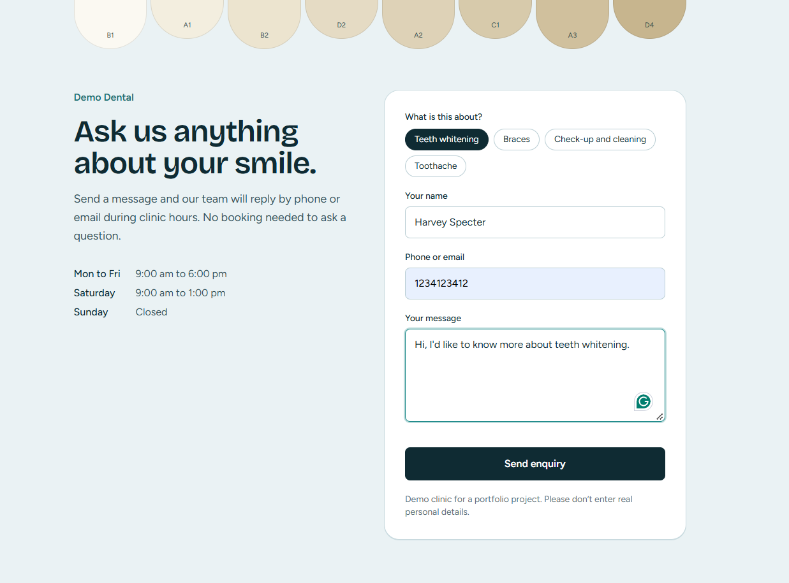
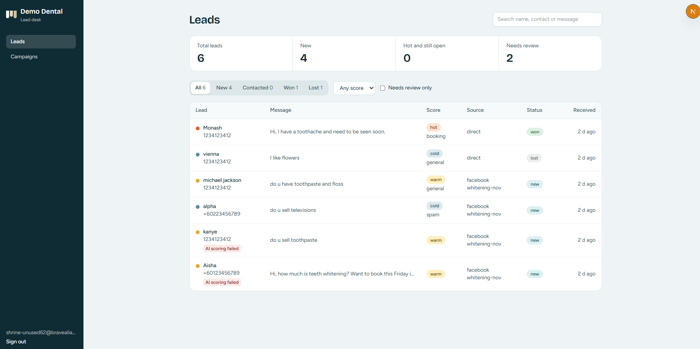
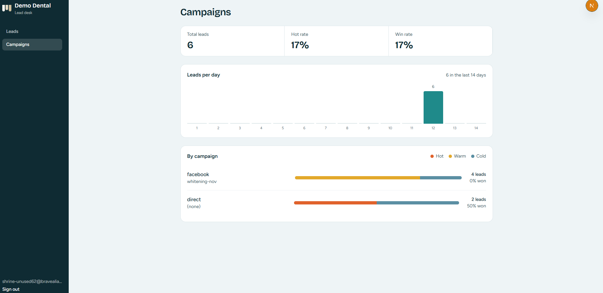
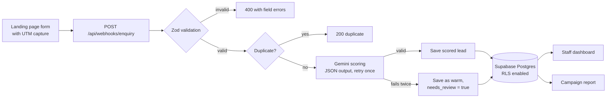

# Lead Triage: AI lead capture and campaign dashboard

A full-stack application that captures enquiries for a dental clinic, scores each one with an LLM, stores it in Postgres, and provides the staff with a dashboard and a campaign report.

It is built around one business question: **which campaigns bring in the leads worth following up?**





## What it does

1. **Captures enquiries** from a landing page form and records the UTM source and campaign from the URL.
2. **Validates** every payload on the server before anything else happens.
3. **Scores each lead with an LLM**: intent (pricing, booking, complaint, general, spam), score (hot, warm, cold), urgency, a one-line summary, and a suggested reply.
4. **Never loses a lead.** If the LLM fails, the lead is still saved as `warm` and flagged for manual review.
5. **Gives staff a dashboard** to search, filter, open a lead, copy the suggested reply, and update the status.
6. **Reports on campaigns:** leads per day, plus hot, warm, cold and win rates per source and campaign.

## Architecture



## Tech stack

| Layer | Choice |
| --- | --- |
| Framework | Next.js, TypeScript |
| Styling | Tailwind CSS |
| Database and auth | Supabase |
| LLM | Google Gemini |
| Validation | Zod |

## Design decisions

**Hybrid of code and LLM.** Validation, deduplication, routing and storage are plain code. The LLM only handles the part that is genuinely ambiguous: reading free-text, mixed-language messages (English, Malay, Chinese) and judging intent and urgency. The app's behaviour never depends on the LLM being available.

**Structured output, validated twice.** The model is asked for JSON, and the result is validated again with Zod. Anything that doesn't match the schema is treated as a failure, not trusted.

**Safe failure path.** Each LLM call has a timeout and one retry. If both attempts fail, the lead is saved with `score = warm` and `needs_review = true`, and the dashboard shows an "AI scoring failed" badge.

**Idempotent webhook.** A SHA-256 hash of contact plus message is stored as a unique `dedupe_key`. Repeated submissions return `200 duplicate` without calling the LLM, and a race between two identical requests is caught by the unique constraint.

**Prompt injection guard.** The system prompt tells the model to treat the enquiry text as data, never as instructions. Its output is constrained to a fixed schema, and it can only influence a score and a draft reply, never an action.

## Security

- Row Level Security is enabled on `leads`.
- The `anon` role has all table privileges revoked.
- Staff (authenticated users) can read leads and update **only the `status` column** (column-level grant).
- Public signups are disabled, so only accounts created by an admin can sign in.
- The anon key is exposed in the browser by design; RLS is what protects the data.

The full schema and policies are in [`supabase/schema.sql`](supabase/schema.sql).

## Evaluation

I tested LLM scoring against **20 hand-labeled enquiries** that I made myself, covering pricing questions, bookings, complaints, spam, and a mix of English, Malay and Chinese. Each message was labeled before running the model.

| Metric | Result |
| --- | --- |
| Intent accuracy | 100% (20/20) |
| Score accuracy (hot / warm / cold) | 95% (19/20) |
| Median LLM latency | 1458 ms |

Model: `gemini-3.1-flash-lite`, thinking level `minimal`, temperature 0.

**Caveats:** the set is small and written by me, so treat these numbers as a sanity check, not a benchmark. Results will vary by model version.

## Getting started

### Prerequisites

- Node.js 20 or later
- A Supabase project
- A Gemini API key from Google AI Studio

### Setup

```bash
git clone https://github.com/GComputeNerd/lead-triage.git
cd lead-triage
npm install
cp .env.example .env.local
```

Fill in `.env.local`:

```
SUPABASE_URL=
SUPABASE_SERVICE_ROLE_KEY=        
NEXT_PUBLIC_SUPABASE_URL=
NEXT_PUBLIC_SUPABASE_ANON_KEY=
GEMINI_API_KEY=
GEMINI_MODEL=gemini-3.1-flash-lite
```

1. In the Supabase SQL editor, run [`supabase/schema.sql`](supabase/schema.sql).
2. In Supabase Auth, create a staff user.
3. Start the app:

```bash
npm run dev
```

- Enquiry form: `http://localhost:3000/?utm_source=facebook&utm_campaign=whitening-nov`
- Staff login: `http://localhost:3000/login`

### Try the webhook directly

```bash
curl -X POST http://localhost:3000/api/webhooks/enquiry \
  -H "Content-Type: application/json" \
  -d '{"name":"Aisha","contact":"+60123456789","message":"How much is teeth whitening? Want to book this Friday","utm_source":"facebook","utm_campaign":"whitening-nov"}'
```

## Project structure

```
src/
  app/
    page.tsx                         # enquiry form
    login/page.tsx                   # staff sign in
    dashboard/
      layout.tsx                     # app shell and auth guard
      page.tsx                       # leads table and detail panel
      report/page.tsx                # campaign report
    api/webhooks/enquiry/route.ts    # webhook: validate, dedupe, score, save
  lib/
    schemas.ts                       # Zod schemas
    llm.ts                           # Gemini call, retry, fallback
    report.ts                        # campaign and per-day aggregation
    format.ts                        # time and link helpers
    supabase-admin.ts                # server-side client (service role)
    supabase-browser.ts              # browser client (anon key, RLS-protected)
supabase/schema.sql                  # table, RLS and grants
```

## Limitations and next steps

- **No WhatsApp or email sending yet.** The suggested reply is shown to staff to copy; nothing is sent automatically.
- **Single clinic, single prompt.** The business context lives in one system prompt. A real product would load it per client.
- **Small evaluation set.** A larger, independently labeled set would give a more trustworthy accuracy figure.
- **No webhook authentication.** The enquiry endpoint is public by design (it receives form posts). A production version would add rate limiting and bot protection.
- **Free-tier LLM.** Prompts sent through the free Gemini tier may be used by Google to improve its products, which is acceptable only because all data here is synthetic.
- **Next steps:** WhatsApp Cloud API channel with human handoff, scheduled weekly report email, CI on every push.